# 열선 취약구역 확인 및 배치 시스템

제22회 한국대학생 산업공학 프로젝트 경진대회 발표
**「열선 융설수의 하류 위험전이 효과를 고려한 골목길 도로열선 최적 배치 — 보행자 중심 MILP 모형의 서울 성북구 적용」**
의 분석과 모형을 지도 위에서 직접 돌려보는 웹 앱입니다.

| 페이지 | 하는 일 |
|---|---|
| **시각화** | 서울 전역 열선 현황, 골목길 미끄러짐 위험, 기대 미끄러짐 순위·분포·출처 |
| **최적배치** | 지역 선택 → 데이터 결합 점검 → 위험구간 지도 → MILP 예산 탐색 · δ 탐색(슬라이더) |
| **설명** | 이 README를 앱 안에서 보기 + GitHub 링크 |

### 배경 (발표자료 2~6쪽)

- 서울 열선 설치는 5년 사이 8.8배로 늘었지만, 위험군 골목길(경사 5.56% 이상, 1,395.6 km) 중 열선이 깔린 곳은 약 4%입니다.
- 결빙취약구간 지정은 대형도로에 약 4배 편중돼 있고, 위험을 세는 기준도 차량 사고 건수입니다.
- 열선이 녹인 물은 경사를 따라 흘러 열선이 없는 하류 구간에서 다시 얼어붙습니다(**하류 위험전이**). 서울 현행 열선에서 상류만 깔린 경계쌍이 1,308곳이고, 그 하류는 일반 골목보다 1.8배 가파르고 1.54배 미끄럽습니다.
- 그래서 이 앱은 **보행자가 실제로 미끄러질 기대 건수**를 기준으로 열선 위치를 고르고, **하류 경계**를 함께 줄이는 배치를 찾습니다.

---

## 목차

1. [실행](#1-실행)
2. [사용 방법 — 인사이트 찾기](#2-사용-방법--인사이트-찾기)
3. [최적화 진행 방법과 민감도 분석 해석](#3-최적화-진행-방법과-민감도-분석-해석)
4. [데이터 처리 과정](#4-데이터-처리-과정)
5. [주의할 점](#5-주의할-점)
6. [데이터 출처와 이용 권한](#6-데이터-출처와-이용-권한)
7. [데이터 파일](#7-데이터-파일)
8. [배포 (Streamlit Community Cloud)](#8-배포-streamlit-community-cloud)
9. [폴더 구조](#9-폴더-구조)

---

## 1. 실행

```bash
cd streamlit_app
python3 -m venv venv && source venv/bin/activate   # 처음 한 번
pip install -r requirements.txt
streamlit run app.py
```

브라우저 `http://localhost:8501`에서 열리고, 왼쪽 메뉴의 **열선 취약구역 확인 및 배치 시스템** 아래에서 **시각화 / 최적배치 / 설명**을 오갑니다.
Python 3.10~3.13, Streamlit 1.40 이상에서 확인했습니다(`st.navigation` 사용). `pulp`는 4.0 미만으로 고정해 두었습니다(4.x는 CBC 솔버가 빠지고 API가 바뀌어 MILP가 동작하지 않음).

---

## 2. 사용 방법 — 인사이트 찾기

### 2-1. 먼저 데이터 점검 표를 본다

메인 페이지 상단의 **데이터 점검** 표 하나로 모든 입력 데이터의 상태를 확인합니다.
빠진 파일이 있으면 표가 자동으로 펼쳐지고, 해당 기능만 꺼진 채로 나머지는 동작합니다.

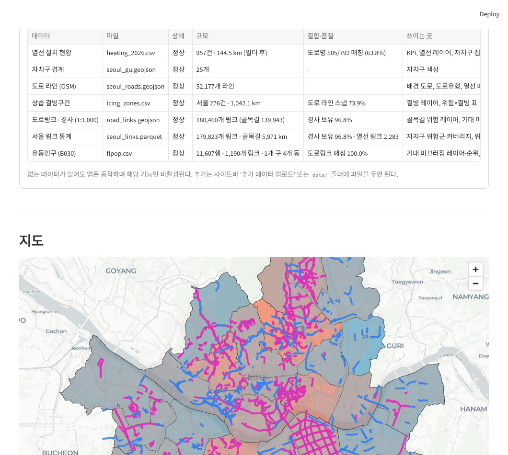

| 열 | 의미 |
|---|---|
| 상태 | 정상 / 없음 |
| 규모 | 행·링크·연장 |
| 결합·품질 | 열선 도로명 매칭률, 결빙구간 스냅률, 경사 보유율, 유동인구 링크 매칭률 |
| 쓰이는 곳 | 그 데이터가 없으면 꺼지는 기능 |

### 2-2. 사이드바 필터·레이어

| 그룹 | 항목 | 쓰는 법 |
|---|---|---|
| 배경 지도 | 위성영상 | 실제 골목 모습을 확인할 때 |
| 레이어 | 자치구 색상 | 아래 '색상 기준'의 지표로 자치구를 칠함 |
| | 열선 설치 도로 (마젠타) | 서울시 열선 설치 현황을 도로명으로 매칭 |
| | 상습 결빙구간 (파랑) | 행정안전부 지정 구간 |
| | 위험군 골목길 & 열선 미설치 | 성북구 4개동의 경사 5.56% 이상·열선 없는 골목(사각지대) |
| | **기대 미끄러짐 = P(MAA<θ) × 유동인구** | 발표 모형의 목적함수 계수. 진하고 굵을수록 위험 |
| | 도로유형 | 골목길(초록)·애매(노랑)·대형도로(파랑) |
| | **골목길 미끄러짐 위험 P(MAA<θ)** | 1:1,000 경사를 미끄러짐 확률로 바꿔 칠함. 기본은 위험군만 |
| 필터 | 자치구, 설치연도 | 지도·표 전체에 적용 |
| 색상 기준 | 총 연장 / 도로 수 / **위험군 골목길 연장** / **위험군 열선 커버리지** | 커버리지가 낮은 구 = 위험 대비 설치가 부족한 구 |
| 도로링크 찾기 | link_id 입력 | 해당 링크로 확대·노랑 강조 |
| 유동인구 데이터 | CSV 업로드 | 기본 `flpop.csv` 대신 다른 B030 파일로 분석 |

유동인구는 발표 모형과 같은 **평일 · 06~11시 · 연령 '전체' 행**으로 고정 집계합니다. `flpop.csv`는 반출 승인된 집계본이라 이 조건의 행만 들어 있고, 다른 B030 파일을 올려도 같은 조건으로 걸러 씁니다.

### 2-3. 예시 — 이런 순서로 인사이트를 찾는다

**예시 1. 어느 구가 위험에 비해 열선이 부족한가**

1. 색상 기준을 **위험군 열선 커버리지(%)** 로 바꾼다 → 붉을수록 커버리지가 높음, 푸를수록 낮음.
2. 분석의 **골목길 경사위험 (자치구별, 1:1,000)** 표를 연다.
3. 성북구: 위험군 골목길 138.8 km(서울 1위), 링크 매칭 기준 커버리지 5.2%. 발표 6쪽의 "가장 많이 깔았지만 커버리지는 19위"와 같은 결론입니다.

**예시 2. 어느 골목이 가장 시급한가**

1. 분석의 **기대 미끄러짐** 항목을 열고 **순위** 탭에서 **TOP 10 한번에**를 누른다.
2. 지도가 해당 구간으로 확대되고 노랑으로 강조된다.
3. 사이드바에서 **기대 미끄러짐** 레이어를 켜면 주변까지 함께 보인다.

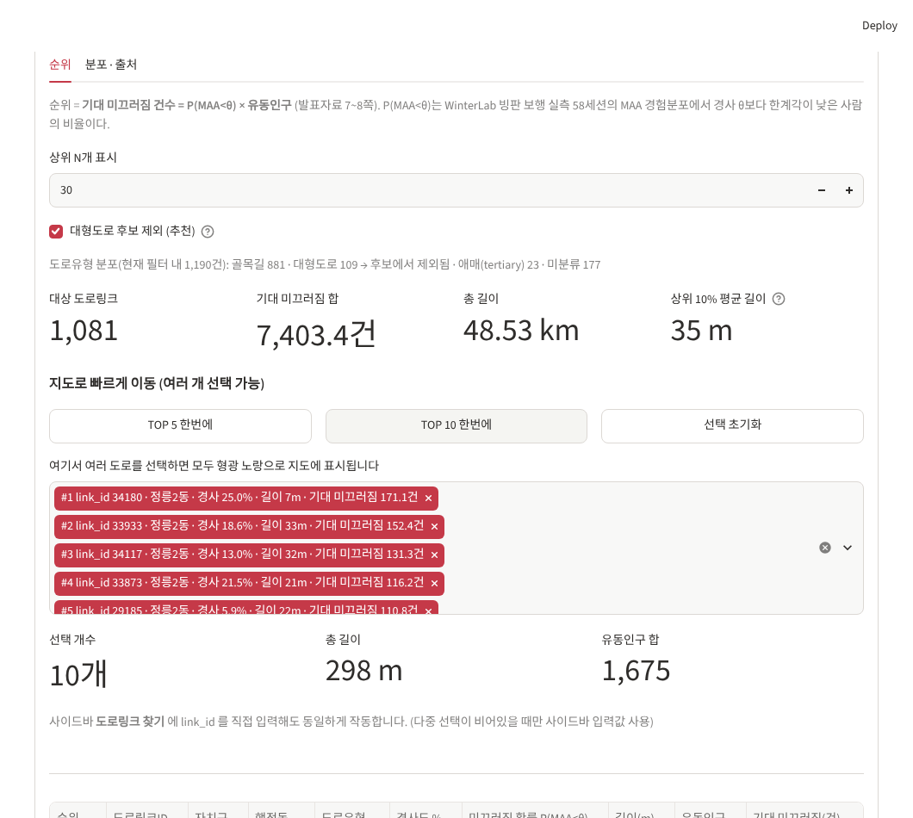

| 골목길 미끄러짐 위험 P(MAA<θ) | 기대 미끄러짐 = P(MAA<θ) × 유동인구 |
|---|---|
| 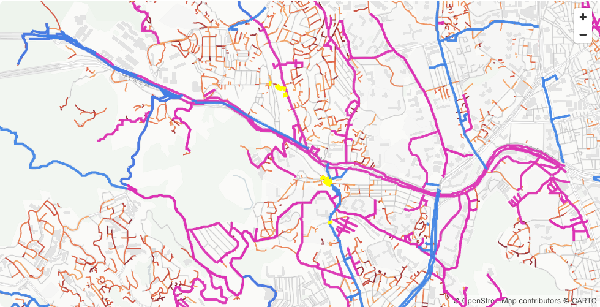 | 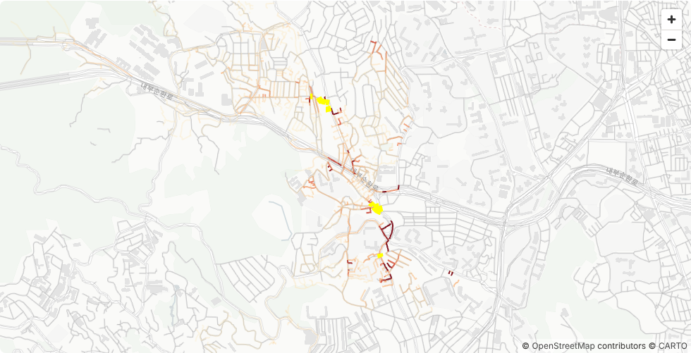 |

**분포 · 출처** 탭에서는 기대 미끄러짐을 이루는 세 값(경사 → P(MAA<θ), 유동인구)의 정의·출처·결합률, 경사–미끄러짐 확률 경험분포, 링크별 분포와 누적 비율(상위 10% 링크가 전체의 약 54%)을 함께 봅니다.

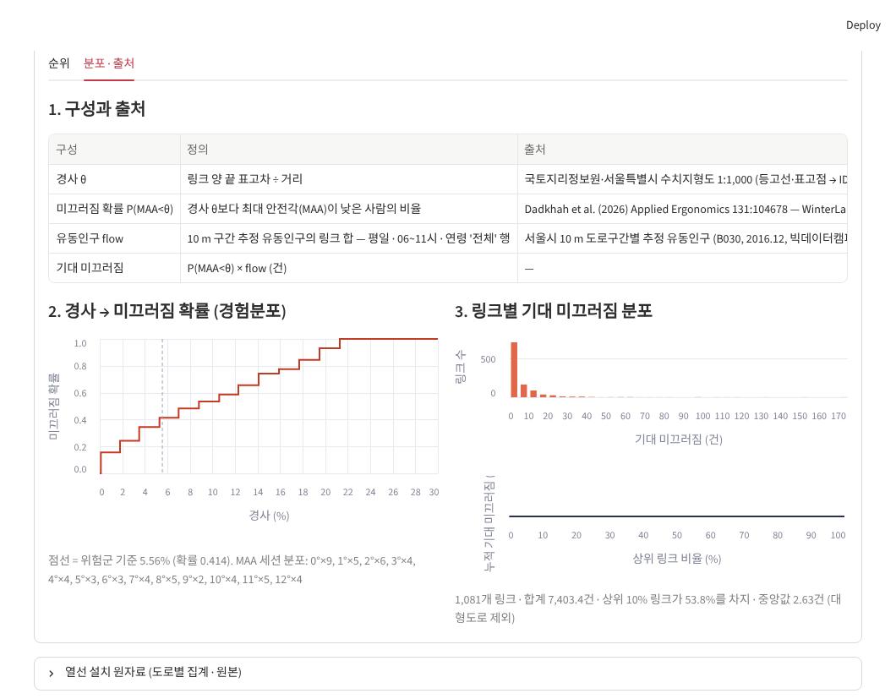

경사만 보면(왼쪽) 북쪽 산자락 골목이 모두 붉지만, 사람이 실제로 다니는 곳을 곱하면(오른쪽) 정릉2동·정릉3동의 몇몇 길목으로 좁혀집니다. 경사만으로 고르면 통행이 적은 곳에 예산이 몰리고, 통행만으로 고르면 평지를 고르게 됩니다(발표 10쪽).

**예시 3. 사각지대 — 위험군인데 열선이 없는 골목**

**위험군 골목길 & 열선 미설치** 와 **열선 설치 도로** 를 같이 켜면, 마젠타(현행 열선) 바로 옆에 빨간 점(미설치 위험군)이 몰려 있는 곳이 보입니다. 하류 경계쌍 후보입니다.

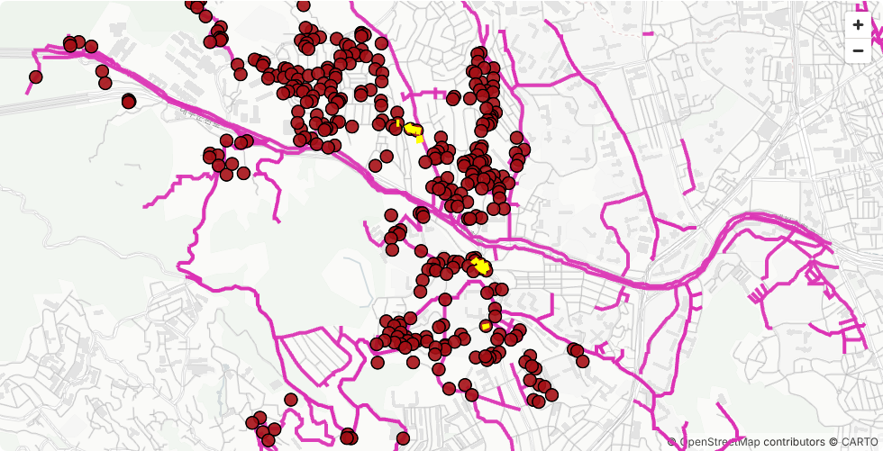

**예시 4. 현행 열선의 하류 경계쌍 확인** → [최적배치](#3-최적화-진행-방법과-민감도-분석-해석) 페이지의 위험구간 탭.

### 2-4. 데이터 등록 방법

**메인 페이지**

| 상황 | 방법 |
|---|---|
| 첫 실행에 도로 라인이 없음 | 데이터 준비 화면이 뜬다 → *Google Drive 다운로드* 또는 *로컬 파일 업로드*(zip 가능, 폴더 구조 무시) |
| 파일을 추가·교체 | 사이드바 맨 아래 **추가 데이터 업로드** (zip · geojson · csv · parquet) |
| 다른 유동인구 자료 | 사이드바 **유동인구 데이터** 업로드 |

**최적배치 페이지** — 앱 `data/`에 없으면 사이드바 *로컬 데이터 폴더*(기본: 상위 `road-analysis/`) 아래 4단계 깊이까지 자동으로 찾습니다.

| 자료 | 인식 조건 | 넣는 방법 |
|---|---|---|
| 서울 링크 | `seoul_links/edges/link_geom.parquet` | `data/` 또는 로컬 폴더, 또는 *파일 추가*에서 zip 업로드 |
| 유동인구 | 파일 이름 무관. 헤더에 `rd_link_cd`·`flpop_co`·`dayweek_cd`(또는 한글 B030 헤더) | 로컬 폴더에 두고 *다시 스캔*, 또는 *파일 추가* 업로드(`data/flow_uploads/`에 저장) |

같은 자료가 여러 벌 있어도(예: `flpop.csv`와 캠퍼스 발췌본) 링크·요일·연령·시간대 키로 중복을 지웁니다.

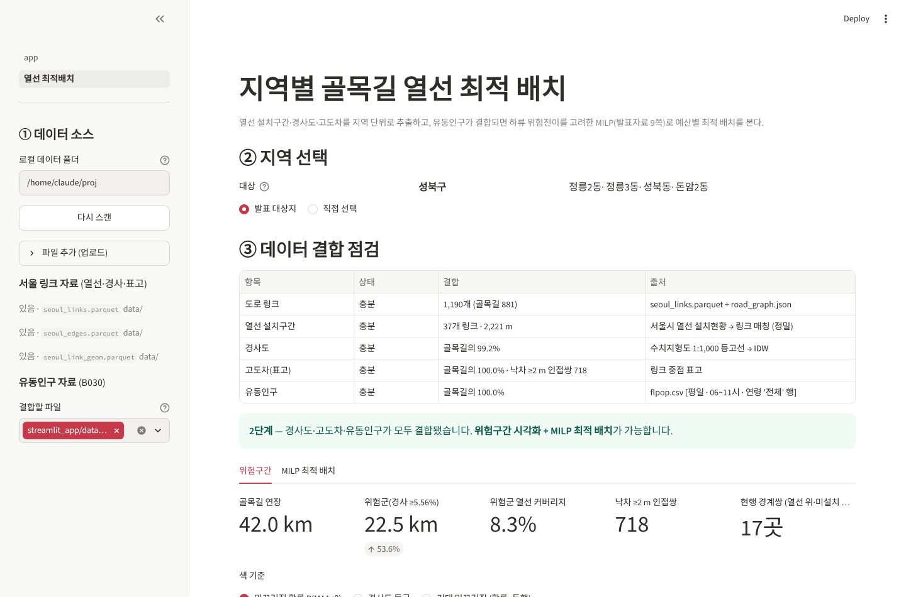

데이터 결합 점검 표에서 골목길 기준 결합률(50%)로 단계를 정합니다.

| 단계 | 조건 | 보이는 것 |
|---|---|---|
| 0 | 경사·표고 부족 | 열선 위치만 |
| 1 | 경사·고도차 결합 | 위험구간 지도, 현행 경계쌍, 동별 위험군 커버리지 |
| 2 | + 유동인구 | 위 + MILP 최적 배치 |

현재 유동인구(`flpop.csv`)는 성북구 4개동만 있어서 다른 지역은 1단계입니다. 예를 들어 강북구 전체를 고르면 아래처럼 위험구간까지만 열립니다. 해당 지역의 B030 CSV를 로컬 폴더에 넣으면 2단계가 됩니다.

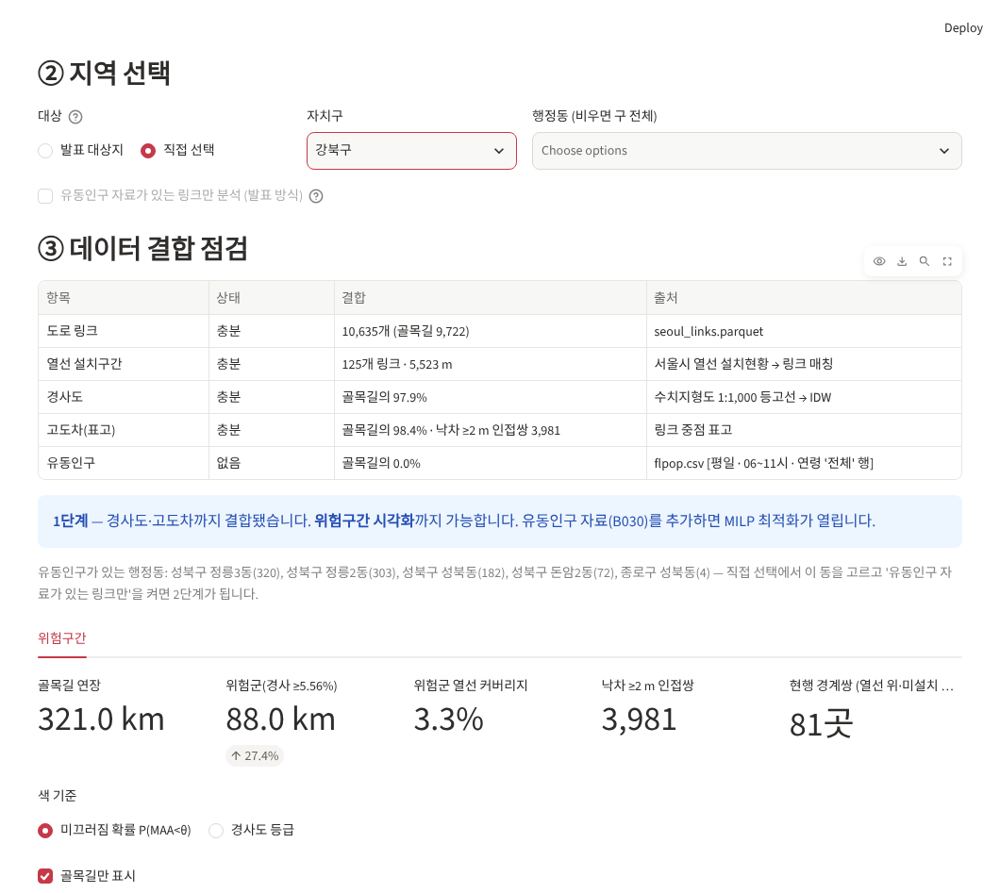

---

## 3. 최적화 진행 방법과 민감도 분석 해석

### 3-1. 모형 (발표자료 7~9쪽)

```
max  Σᵢ riskᵢ·flowᵢ·xᵢ  −  δ · Σ_(i,j)∈D wᵢⱼ·bᵢⱼ
s.t. Σᵢ lengthᵢ · COST_PER_M · xᵢ ≤ B          (예산)
     bᵢⱼ ≥ xᵢ − xⱼ        ∀(i,j) ∈ D          (경계 발생 선형화)
     xᵢ ∈ {0,1},  bᵢⱼ ∈ [0,1]
```

| 기호 | 정의 |
|---|---|
| riskᵢ | P(MAA < θᵢ) — 토론토재활원 WinterLab 빙판 경사 보행 실험 58세션의 최대 안전 경사(MAA) 경험분포. 경사 5.56%에서 0.414, 21.3% 이상 1.0 |
| flowᵢ | 서울시 10 m 도로구간 추정 유동인구(B030, 2016.12), 평일 06~11시, 링크 단위 합산 |
| riskᵢ·flowᵢ | **기대 미끄러짐 건수** — 열선을 깔면 막을 수 있는 양(편익) |
| D | 인접하고 zᵢ − zⱼ ≥ 2 m인 쌍(i가 상류). 4개동에 718쌍 |
| wᵢⱼ | 경계 통행량 × 하류 미끄러짐 확률. 경계 통행량은 도로망 current-flow 엣지전류(Newman 2005)를 MSA로 고정점까지 반복해 구함 |
| bᵢⱼ | 상류만 깔리고 하류가 비면 1 → 하류 전이위험 패널티 |
| COST_PER_M | 15억 원 / 1,700 m (3 m 1개 차로) |

### 3-2. 진행 순서 (최적배치 페이지)

1. **지역 선택** — *발표 대상지*(정릉2·정릉3·성북·돈암2동)는 정밀 열선 매칭(`road_graph.json`)을 써서 발표 수치를 재현합니다. *직접 선택*에서는 '유동인구 자료가 있는 링크만 분석'을 켜 두는 것이 발표 방식입니다.
2. **위험구간 탭** — 현행 열선과 경계쌍(열선 위·미설치 아래, 4개동 17곳)을 먼저 확인합니다.

   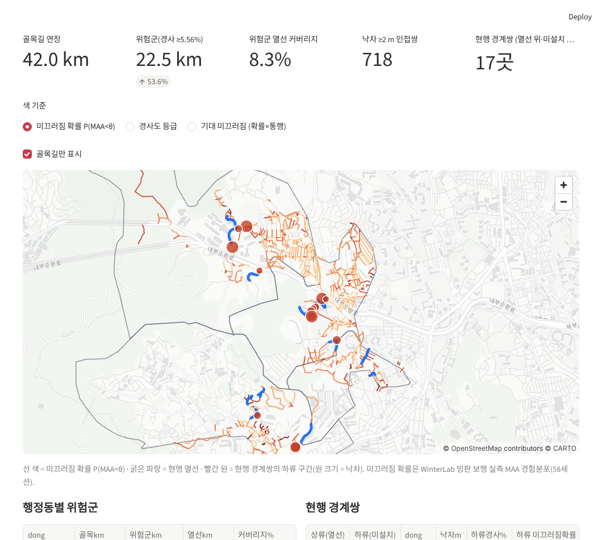

3. **MILP 탭 — 공통 파라미터.** 아래 두 탐색 탭이 함께 씁니다.

   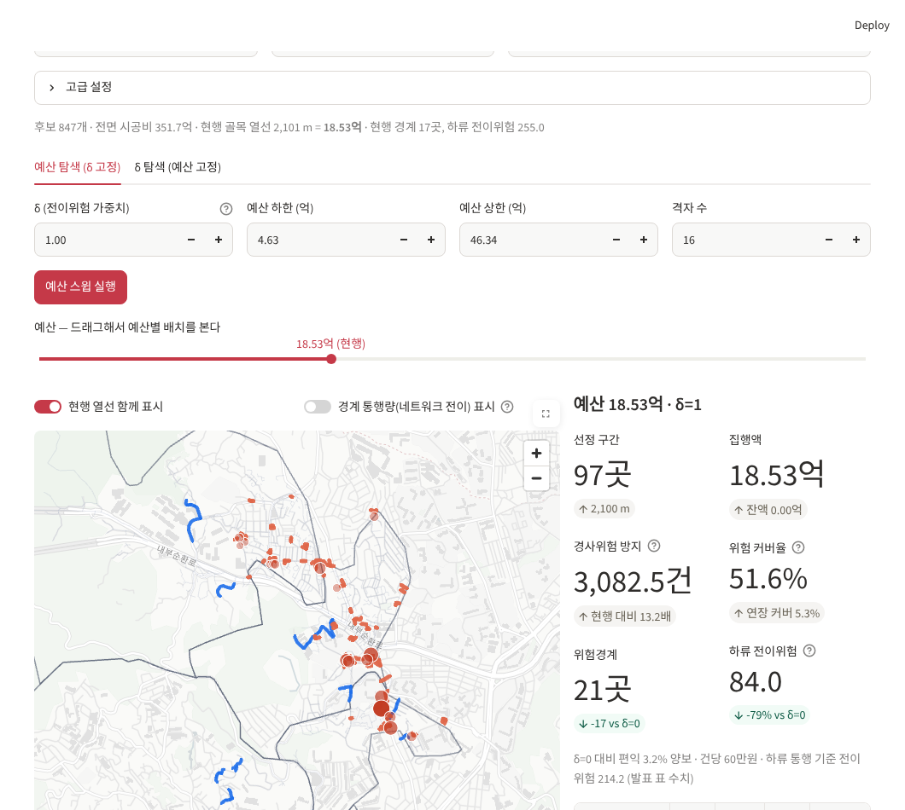

   | 파라미터 | 기본 | 의미 |
   |---|---|---|
   | h_min | 2 m | 경계로 볼 최소 낙차 |
   | 미터당 설치비 | 882,353원 | 바꾸면 같은 예산으로 깔 수 있는 길이가 바뀜 |
   | 전이 가중치 | 엣지전류·MSA | *빠른 근사*는 하류 risk×flow만 사용 |
   | 고급 설정 | MSA 15회, 시간 제한 없음 | 큰 지역은 MILP 시간 제한과 source 상한을 둠 |

4. **예산 탐색 (δ 고정)** — δ(기본 **1**)와 예산 범위를 정하면 격자의 각 예산에서 제안(δ)과 기준(δ=0)을 함께 풉니다(4개동 16점 ≈ 15초, 이후 슬라이더는 즉시). 현행 투입액(18.53억)과 +30%(24.10억)는 격자에 자동으로 들어갑니다.

   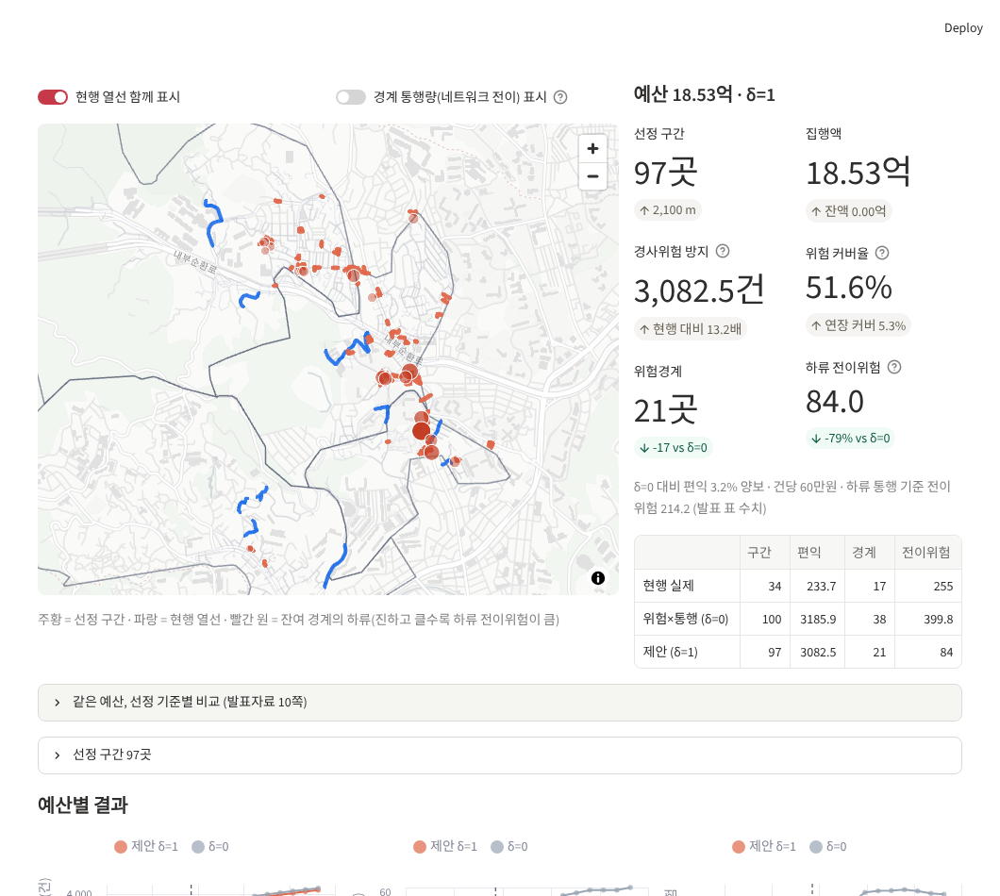

   지도: 주황 = 선정 구간, 파랑 = 현행 열선, 빨간 원 = 남은 경계의 하류(진하고 클수록 하류 전이위험 큼). **경계 통행량(네트워크 전이) 표시**를 켜면 낙차 2 m 이상 인접쌍을 경계 통행량(엣지전류)에 비례한 굵기의 남색 선으로 그립니다 — 어느 경계로 사람이 많이 지나가는지가 보입니다.

5. **δ 탐색 (예산 고정)** — 예산 하나를 고르고 δ 격자(기본 0~12, 13점)를 풉니다. 편익 손실–전이위험 감소 곡선, 권장 δ(파레토 전환점), 편익 5% 손실 상한이 나오고, **δ 슬라이더**를 끌면 그 δ의 배치가 지도와 통계로 바뀝니다. 전이위험 기준은 경계 통행 / 하류 통행 중에서 고를 수 있습니다(3-4 참고).

   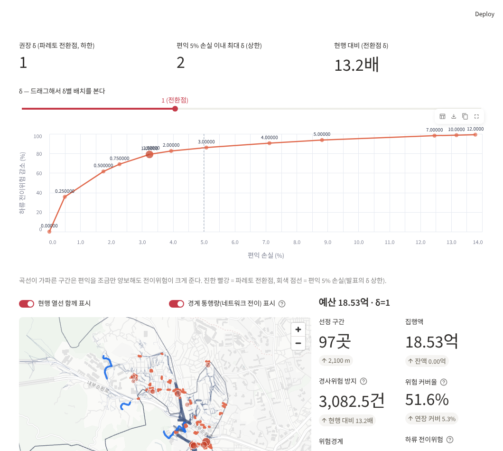

   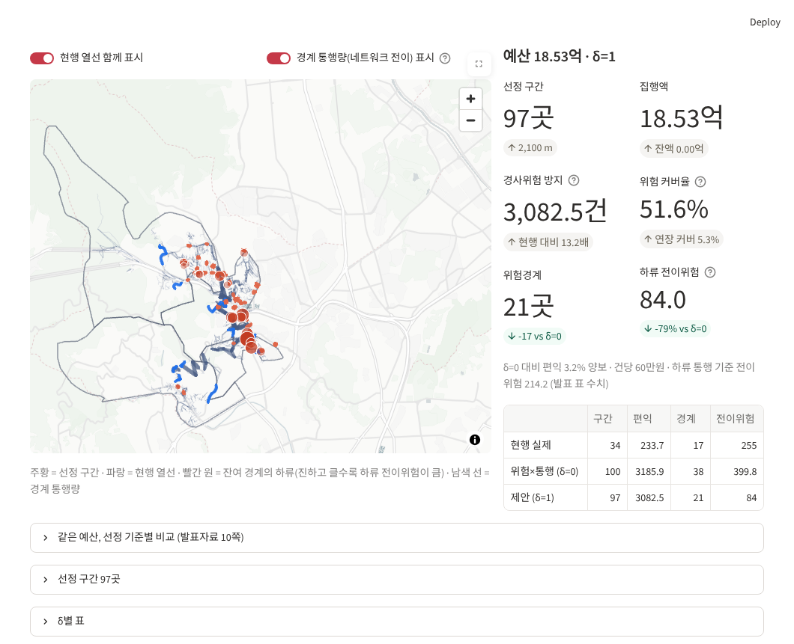

6. **같은 예산, 선정 기준별 비교** — 다른 기준과 비교합니다(발표 10쪽 표의 축).

   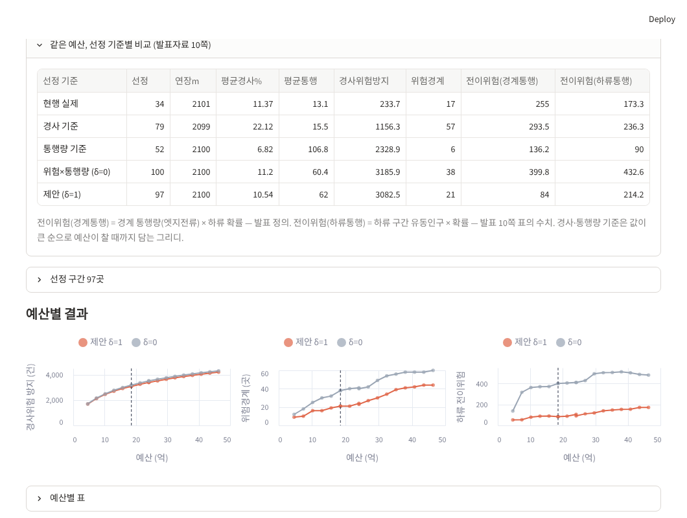

   현행 예산 18.53억:

   | 선정 기준 | 선정 | 평균경사 | 평균통행 | 경사위험 방지 | 위험경계 | 전이위험 (경계 통행) | 전이위험 (하류 통행) |
   |---|---|---|---|---|---|---|---|
   | 현행 실제 | 34 | 11.37% | 13.1 | 233.7 | 17 | 255.0 | 173.3 |
   | 통행량 기준 | 52 | 6.82% | 106.8 | 2,328.9 | 6 | 136.2 | 90.0 |
   | 위험×통행량 (δ=0) | 100 | 11.20% | 60.4 | 3,185.9 | 38 | 399.8 | 432.6 |
   | 제안 (δ=4) | 98 | 10.04% | 59.9 | **2,959.1** | **13** | **38.0** | **124.2** |

   같은 돈으로 현행 대비 편익 12.7배, δ=0 대비 편익 7%를 양보하고 위험경계를 38곳 → 13곳으로 줄입니다(발표 S1). 하류 전이위험은 현행 대비 경계 통행 기준 −85%, 하류 통행 기준 −28%(발표 수치).

### 3-3. 민감도 분석 읽는 법 (발표자료 11쪽)

**예산 탐색의 곡선 3개**

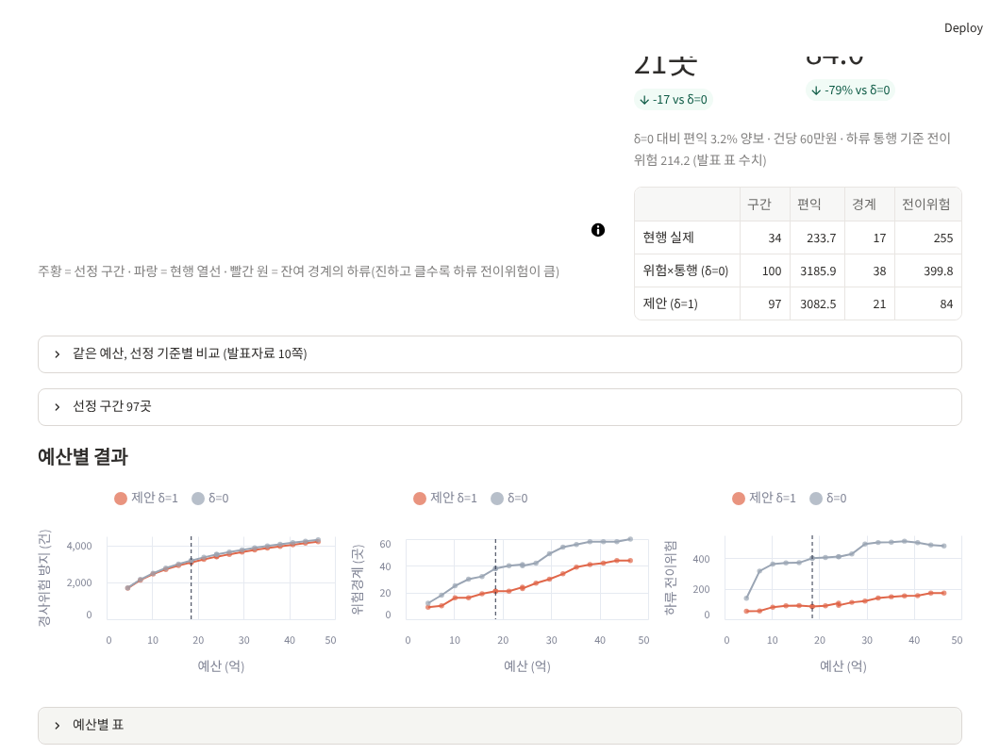

| 곡선 | 읽는 법 |
|---|---|
| 경사위험 방지 | 예산이 늘수록 오르지만 기울기가 줄어든다(오목). 꺾이는 지점 이후는 돈을 더 써도 막는 건수가 적게 는다. |
| 위험경계 | 회색(δ=0)과 주황(제안)의 **간격**이 δ가 만드는 경계 감소량. |
| 하류 전이위험 (경계 통행) | 경계 수보다 연속적인 지표. 위 두 곡선과 함께 "편익을 얼마 양보하고 전이위험을 얼마 줄였나"를 읽는다. |

**δ 탐색의 트레이드오프 곡선**

- 가로축 = 편익 손실(%), 세로축 = 하류 전이위험 감소(%). 점 옆 숫자가 δ.
- 곡선이 가파른 구간은 편익을 조금만 양보해도 전이위험이 크게 준다. 그 뒤로는 손실만 늘고 감소는 둔해진다.
- **권장 δ (하한)** = 양 끝점을 잇는 직선에서 가장 먼 점(Kneedle, 파레토 전환점), 진한 빨강.
- **상한** = 편익 손실 5% 이내의 가장 큰 δ, 회색 점선.

현행 예산 18.53억, 4개동 결과:

| 전이위험 기준 | 권장 δ (전환점) | 5% 상한 | δ=1 | δ=4 |
|---|---|---|---|---|
| 경계 통행 (발표 정의) | **1** | **2** | 편익 −3.2%, 전이위험 −79% | 편익 −7.1%, 전이위험 −90.5% |
| 하류 통행 (발표 표) | 2 | 2 | 편익 −3.2%, 전이위험 −50.5% | 편익 −7.1%, 전이위험 −71.3% |

발표의 S1(δ=4)은 편익 손실 7.1%로 자체 기준(5% 상한)을 넘습니다. 이 기준을 그대로 적용하면 현행 예산의 δ 범위는 1~2입니다(3-4 참고).

**δ를 정하는 기준 (발표 방식)**

1. 예산 B마다 δ 0~12를 전수 탐색한다(발표: 예산 0.5~30% × δ, 10,000점).
2. 해마다 (경사위험 방지, 하류 전이위험) 두 지표를 얻고 예산선별 파레토 프런트를 그린다.
3. 프런트의 **파레토 전환점을 δ 하한**, **편익 5% 손실점을 상한**으로 둔다.
4. 그 범위 안에서 예산과 목적에 맞게 고른다.

| 시나리오 | 예산 | δ | 선정 | 경사위험 방지 | 위험경계 | 해석 (발표) |
|---|---|---|---|---|---|---|
| 현행 | 18.53억 | — | 34 | 233.7 | 17 | |
| S1 재배치 | 18.53억 | 4 | 98 | 2,959.1 (12.7배) | 13 | 전이위험 −28% |
| S2 효율 최대 | 24.10억 (+30%) | 5 | 112 | 3,160.6 (13.5배) | 11 | 전이위험 −44% |

S1과 S2에 공통으로 들어가는 97구간이 최우선 설치 대상이고, 예산을 30% 늘리면 15구간이 추가됩니다(발표 12쪽).

### 3-4. 평가지표 점검 (2026-11-11)

발표자료의 정의와 계산을 앱 코드로 다시 맞춰 본 결과입니다.

| 항목 | 발표 | 점검 결과 | 앱의 처리 |
|---|---|---|---|
| 하류 전이위험 정의 | 10쪽: "경계 통행량 × 하류 미끄러짐 확률" | 10쪽 표의 수치(173.3 / 432.6 / 124.2)는 **하류 구간 유동인구 × 확률**로 계산돼 있다. 목적함수는 경계 통행량(엣지전류)을 쓰므로 **최적화한 양과 평가한 양이 다르다** | 두 값을 모두 계산. 기본 지표는 정의와 같은 **경계 통행** 기준, 하류 통행 기준은 "발표 표 수치"로 병기 |
| 전이위험 척도 | — | MSA 안의 wᵢⱼ는 반복마다 평균으로 다시 맞추므로 배치 간 비교에 쓸 수 없다. 현행·그리디 배치는 wᵢⱼ가 정의되지 않았다(후보 쌍에만 정의) | 새 열선이 없는 상태의 척도 k₀ 하나로 모든 배치를 잼: 배치마다 결빙 구간 컨덕턴스를 낮춰 엣지전류를 다시 구하고 Σ k₀·I·riskⱼ |
| δ 선택 기준 | 11쪽: 전환점 ~ 편익 5% 손실 | S1 δ=4는 편익 손실 7.1%로 상한 초과 | δ 탐색 탭에서 하한·상한을 자동 표시 |
| MSA 수렴 | — | 기본 8회로는 S2(+30%, δ=5)가 수렴하지 않음(10회에 수렴) | 기본 15회 |
| S2 재현 | 112구간 · 3,160.6 · 경계 11 | 앱(전 source, 수렴): 110구간 · 3,170.7 · 경계 10 | 발표 실행은 source 200개 근사로 추정. 앱은 전 source 사용 |
| 경사 기준 그리디 | 78구간 · 1,121.8 · 경계 59 | 앱 79구간 · 1,156.3 · 경계 57 (넘치면 멈추는 규칙이면 78구간이나 편익·경계는 여전히 다름) | 그대로 두고 차이를 기록 |
| 커버리지 (12쪽 7.1% / 8.0%) | — | 후보·골목·전체 연장 어느 기준으로도 재현되지 않음 | 앱은 '위험 커버율'(막는 기대 미끄러짐 ÷ 후보 전체)과 '연장 커버'(선정 연장 ÷ 후보 연장)를 정의와 함께 표시 |

---

## 4. 데이터 처리 과정

```
수치지형도 1:1,000 (국토지리정보원, 서울 2,489 도엽)
  └ 등고선·표고점 파싱 → IDW 보간 → 링크 양 끝 표고 z → 경사 θ = |Δz| / 거리
TBGIS 도로링크 180,460개 (서울시)
  ├ OSM highway 태그 공간매칭 → 골목길 / 대형도로 / 애매
  ├ 끝점 5 m 스냅 → 인접 엣지
  └ 링크 중점 표고 → 낙차 ≥ 2 m 인접쌍 D
서울시 열선 설치 현황 (주소 문자열)
  └ 괄호·축약·오탈자 정리 → VWorld 지오코딩 → 시점~종점 최단경로로 링크에 라우팅
행정안전부 상습 결빙구간 → 50 m 이내 링크 스냅
B030 10 m 구간 유동인구 (2016.12)
  └ 평일 · 06~11시 · 연령 '전체' 행 → 링크 단위 합산
WinterLab MAA 58세션 (Dadkhah et al. 2026, 그림에서 복원)
  └ 경험분포 → risk(θ) = P(MAA < θ)
────────────────────────────────────────────
→ seoul_links.parquet  (경사·표고·열선·결빙·도로유형)
→ road_graph.json       (4개동 1,190 링크, 정밀 열선 매칭)
→ MILP: 후보 = 골목길 ∩ 열선 미설치 (4개동 847구간)
        w_ij = current-flow 엣지전류(2홉 버퍼로 동 경계 밖 연결 복원) × risk_j, MSA 고정점
```

| 단계 | 스크립트 (`scripts/`) |
|---|---|
| 도엽 파싱·경사 | `parse_citywide_chunk.py`, `finish_citywide_slope_v2.py`, `verify_tile_coverage.py` |
| 도로유형 | `classify_road_type.py` |
| 열선 매칭 | `heating_address_split_v2.py`, `geocode_heating_citywide.py` |
| 서울 데이터셋 | `build_seoul_dataset.py`, `build_link_geom.py` |
| 4개동 그래프 | `build_road_graph.py` |
| δ·예산 실험 | `run_delta_experiment.py`, `run_budget_delta_grid.py` |

모형 코드: `utils/risk.py`(MAA 경험분포), `utils/milp.py`(MILP·엣지전류·MSA, 앱과 배치 스크립트가 공유), `utils/region.py`(지역 단위 결합·스윕).

---

## 5. 주의할 점

**자료와 모형의 한계 (발표자료 14쪽)** — 결과는 *골목길 후보군 안에서의 전략 비교*로 해석합니다.

| 구분 | 한계 | 영향 |
|---|---|---|
| 데이터 | 낙상 위치 기록 없음, 5 m 등고선 기반 경사, 유동인구 2016년 | 실제 사고 감소를 직접 검증하지 못함. 경사 오차·자료 시점이 순위에 영향 |
| 결빙 확률 | 구간 간 결빙 위험을 동일하게 가정 | 실제 결빙 빈도에 따른 우선순위 차이 미반영 |
| 대상 | 골목길 보행 위험만, 대형도로·차량 편익 제외 | 전체 도로망 투자 우선순위로 일반화 어려움 |
| 제설 | 제설제·인력·장비 효과 미반영 | 기존 대응이 충분한 구간은 편익 과대평가 가능 |

**위험도 P(MAA<θ)**

- 논문 그림에서 74세션 중 58세션만 복원한 추정치이고, 1° 단위라 계단 모양입니다. 경사 21.3% 이상은 모두 1.0으로 포화합니다.
- 참가자 평균 30세로 고령자가 포함되지 않았습니다. 빙판임을 알고 걸었으므로 실제 위험보다 낮게 나왔을 가능성이 큽니다(보수적 추정).
- 걸음당이 아니라 **통과 1회당** 확률입니다. 그래서 유동인구(사람 수)와 곱합니다.

**앱 사용 시**

- 최적배치는 **현행 열선을 후보에서 뺀 재배치** 가정입니다. "같은 돈을 모형대로 썼다면"의 비교이지 추가 설치 계획이 아닙니다.
- 위험경계 수는 D 전체(발표 10쪽 기준)로 셉니다. 하류 전이위험은 경계 통행 기준(발표 정의)과 하류 통행 기준(발표 표 수치) 두 가지가 있어 같은 배치라도 값이 다릅니다(3-4).
- 예산·δ 탐색 결과는 브라우저 세션 메모리에 있습니다. 새로고침하거나 설정을 바꾸면 다시 실행해야 합니다.
- 자치구 커버리지는 링크에 매칭된 열선 기준이라 자치구 신고 연장(대형도로 포함)과 다릅니다.
- 직접 선택한 큰 지역(후보 수천 개)에 MILP 시간 제한을 걸면 최적해가 아니라 시간 안의 최선해입니다.
- 유동인구는 성북구 4개동만 들어 있습니다. 다른 지역을 MILP로 돌리려면 그 지역 B030 자료가 필요합니다.

---

## 6. 데이터 출처와 이용 권한

### 6-1. 출처와 파일명

원본 파일명 → 앱에서 쓰는 파일명 순서로 적었습니다. 원본은 `road-analysis/` 상위 폴더나 캠퍼스 반출 자료에 있고, 앱은 오른쪽 파일만 읽습니다.

| 데이터 | 제공 · 받은 곳 | 원본 파일 | 앱 파일 (`data/`) | 시점 |
|---|---|---|---|---|
| 도로열선 설치현황 | 서울특별시 도로관리과 · [서울 열린데이터광장 OA-22584](https://data.seoul.go.kr/dataList/OA-22584/F/1/datasetView.do) | `자치구별 도로열선 설치현황_20260531.csv` | `heating_2026.csv` (원본 그대로, 993건) | 2026-05-31 |
| 열선 주소 좌표 | 국토교통부 VWorld 지오코딩 API로 시점·종점 주소 변환 | — | `heating_geocode_all.json` (repo 미포함) → `seoul_links.parquet`의 `heat` | 2026-09 |
| 상습 결빙구간 | 행정안전부 · 공공데이터포털 | `행정안전부_상습 결빙구간_20251107.csv` | `icing_zones.csv` (전국 3,358행, 앱에서 서울만 필터) | 2025-11-07 |
| 수치지형도 1:1,000 | 국토지리정보원·서울특별시 · [국토정보플랫폼](https://map.ngii.go.kr) | `(B010)수치지도_<도엽번호>_2025_<id>.zip` × 2,489 | 원본 미포함. 파생 경사·표고 → `seoul_links.parquet`, `road_graph_nodes_elev.csv` | 2024~2025 |
| 10 m 도로구간별 추정 유동인구 (B030) | 서울특별시 · 서울시 빅데이터캠퍼스 (**반출 승인 완료**) | `result(4개 행정동 발췌자료).csv` (자료안내서 `B030_서울시 10m 도로구간별 추정 유동인구 데이터_20220315.hwp`) | `flpop.csv` (원본과 동일) | 2016-12 |
| 도로링크 | 서울특별시 · 서울시 빅데이터캠퍼스 (**반출 승인 완료**) | `TBGIS_ROAD_LINK_FRM.shp` | `road_links.geojson`(Drive) → `seoul_links.parquet`, `seoul_edges.parquet`, `seoul_link_geom.parquet`, `road_graph.json` | 2016-05 |
| 도로 라인 · 도로유형 | OpenStreetMap 기여자 · Overpass API | `seoul_roads_raw.geojson` (Overpass 내보내기) | `seoul_roads.geojson`(Drive), 링크별 `road_type` | 2026-05 |
| 자치구 경계 | 통계청 센서스 경계(2013) · [southkorea/seoul-maps](https://github.com/southkorea/seoul-maps) | `seoul_municipalities_geo_simple.json` (이전 README 기록) | `seoul_gu.geojson` (속성을 `gu`로 정리) | 2013 |
| **행정동 경계** | 행정안전부 행정동 고시 기준 · **[vuski/admdongkor](https://github.com/vuski/admdongkor)** | `HangJeongDong_ver20230701.geojson` (2023-07-01 기준판) | `seongbuk_dong.geojson`(성북구 20개동), `seodaemun_dong.geojson`(서대문구 14개동) — 해당 구만 잘라냄, 속성(`adm_nm`, `adm_cd2` 등)은 원본 그대로 | 2023-07-01 |
| MAA 경험분포 | Dadkhah et al. (2026), *Applied Ergonomics* 131:104678 · 논문 Fig.1 판독 | — | `utils/risk.py`의 세션 수 13개 값 | — |
| 배경 지도 | CARTO · OpenStreetMap / Esri World Imagery | 지도 표시 때 실시간 호출 | 미포함 | — |

### 6-2. 이용 조건

| 데이터 | 조건 | 이 프로젝트의 처리 |
|---|---|---|
| 도로열선 설치현황 | 공공누리 제4유형 — 출처표시 + 상업적 이용금지 + 변경금지 | 원본 CSV를 수정하지 않고 그대로 두고, 주소의 위치(좌표)만 찾아 도로링크에 붙였다. 원 저작물 내용을 바꾸는 가공이 아니므로 변경금지에 해당하지 않는다고 판단. 비상업 학술 목적, 출처 표기 |
| 열린데이터광장 전반 | 결과를 보여줄 때 "서울특별시 공공데이터" 사용을 표시 | README·발표자료에 출처 표기 |
| B030 유동인구 · 도로링크 | 빅데이터캠퍼스 반출 절차 필요 | 집계 자료로 **반출 승인 완료** |
| 수치지형도 1:1,000 | 국토정보플랫폼 공개 데이터 | 원본은 repo에 넣지 않고 파생 경사·표고만 사용. "국토지리정보원·서울특별시 1/1,000 수치지형도" 출처 표기 |
| 상습 결빙구간 | 공공데이터포털 이용허락범위 | 출처 표기 |
| OpenStreetMap | ODbL — "© OpenStreetMap contributors" 표기 | 도로유형(`road_type`)은 OSM 파생값이므로 공개 배포 시 ODbL 조건을 따른다 |
| 자치구·행정동 경계 | 각 저장소 고지(통계청 자료는 자유 공유·변형) | 출처 표기 |
| 배경 지도 | 타일 저작권 표기 | pydeck 지도 하단에 자동 표기 |

출처 표기 예시:

> 본 저작물은 서울특별시가 공공누리 제4유형으로 개방한 '자치구별 도로열선 설치현황'을 이용하였으며, 해당 저작물은 서울 열린데이터광장(data.seoul.go.kr)에서 무료로 내려받을 수 있습니다.

### 6-3. API 키 — 절대 커밋하지 않는다

키는 코드에 적지 않고 **환경변수**로만 읽습니다(`utils/env.py`의 `get_secret`). 앱 실행에는 키가 필요 없고, 열선 주소를 다시 지오코딩할 때(`scripts/geocode_heating_*.py`)만 씁니다.

```bash
# 방법 1 — 셸 환경변수
export VWORLD_API_KEY=발급받은키

# 방법 2 — .env 파일 (gitignore 됨)
cp .env.example .env    # 그다음 .env 에 값 입력
```

| 파일 | 커밋 |
|---|---|
| `.env`, `.env.*`, `.streamlit/secrets.toml` | 안 함 (`.gitignore`) |
| `.env.example` | 함 (키 이름만, 값 없음) |

Streamlit Community Cloud에 비밀값이 필요하면 앱 설정의 **Secrets**에 넣습니다. 저장소에 넣지 않습니다.

**계정 권한**: Streamlit Community Cloud 배포에는 GitHub 계정의 저장소 접근 허용이 필요합니다. Claude가 직접 push하려면 claude.ai 설정에서 GitHub 연결(Claude GitHub App)이 필요하고, 지금은 로컬에서 `git push` 합니다.

---

## 7. 데이터 파일

**repo에 포함** (`.gitignore` 화이트리스트, 합계 약 16 MB)

| 파일 | 크기 | 용도 |
|---|---|---|
| `heating_2026.csv` | 50 KB | 자치구별 열선 설치 현황 |
| `icing_zones.csv` | 564 KB | 행정안전부 상습 결빙구간 (전국, 앱에서 서울 필터) |
| `seoul_gu.geojson` | 36 KB | 자치구 경계 |
| `flpop.csv` | 756 KB | B030 유동인구 (성북구 4개동, 2016.12, 반출 승인 집계본) |
| `seoul_links.parquet` | 4.4 MB | 서울 180,460 링크 — 열선·경사·표고·도로유형·결빙 |
| `seoul_edges.parquet` | 2.7 MB | 링크 인접 |
| `seoul_link_geom.parquet` | 6.8 MB | 링크 형상 |
| `road_graph.json` | 420 KB | 4개동 그래프(정밀 열선 매칭) |
| `road_graph_nodes_elev.csv` | 108 KB | 4개동 링크 중점 표고 |
| `seongbuk_dong.geojson`, `seodaemun_dong.geojson` | 93 KB | 행정동 경계 |

`.gitignore`의 `!data/...` 줄 끝에 주석을 붙이면 규칙이 무시됩니다. 설명은 윗줄에 씁니다.

**별도 배포** (Google Drive zip, 첫 실행 시 자동 다운로드)

| 파일 | 크기 | 용도 |
|---|---|---|
| `seoul_roads.geojson` | 18 MB | 메인 지도 도로 라인 (필수) |
| `road_links.geojson` | 96 MB | 골목길 위험·기대 미끄러짐 레이어, 순위 |

최신 묶음 `road_data_20261111.zip`(10 MB)이 [Google Drive](https://drive.google.com/file/d/12fNV9vIaUQrHqm4MvdsoCiqZ94rAU7Py/view)에 있고, `utils/data_bootstrap.py`의 `DEFAULT_DRIVE_URL`에 연결돼 있습니다. 다른 링크를 쓰려면 `.streamlit/secrets.toml`의 `DATA_DRIVE_URL`로 덮어씁니다.

---

## 8. 배포 (Streamlit Community Cloud)

Streamlit은 브라우저와 서버가 WebSocket을 계속 열어 두고, 화면 상태를 서버 메모리에 들고 있는 구조입니다. 그래서 요청마다 짧게 떴다 꺼지는 서버리스(Vercel 등)와 맞지 않고, 프로세스가 계속 살아 있는 곳에 올려야 합니다. Streamlit Community Cloud는 무료이고 GitHub 저장소만 연결하면 됩니다.

1. GitHub에 push된 저장소(`sqine/visualize-road`)를 준비합니다. 배포할 브랜치에 `app.py`, `pages/`, `utils/`, `requirements.txt`, 화이트리스트 데이터가 있어야 합니다.
2. <https://share.streamlit.io> 에 GitHub 계정으로 로그인 → **Create app** → *Deploy a public app from GitHub*.
3. Repository `sqine/visualize-road`, Branch `main`, Main file path `app.py`를 고릅니다.
4. *Advanced settings*에서 Python 3.12를 고르고, 필요하면 Secrets에 `DATA_DRIVE_URL = "https://drive.google.com/file/d/…/view"`를 넣습니다.
5. **Deploy** → 몇 분 뒤 `https://<이름>.streamlit.app` 주소가 생깁니다. 이후 `main`에 push하면 자동으로 다시 배포됩니다.
6. 첫 접속 때 데이터 준비 화면에서 **다운로드 시작**을 누릅니다.

새 가상환경에 `requirements.txt`만 설치해 점검한 결과(2026-11-11): 시각화는 데이터 준비 화면까지, 최적배치 페이지는 repo 데이터만으로 MILP까지 오류 없이 동작했습니다.

---

## 9. 폴더 구조

```
streamlit_app/
├── app.py                    진입점 — 내비게이션(열선 취약구역 확인 및 배치 시스템)
├── pages/
│   ├── visualize.py          시각화
│   ├── optimize.py           최적배치 (예산 탐색 · δ 탐색)
│   └── guide.py              설명 (이 README 렌더링)
├── utils/
│   ├── region.py             지역 데이터 탐색·결합 점검·그래프·예산/δ 스윕·평가지표
│   ├── milp.py               MILP + current-flow 가중치 (단일 출처)
│   ├── risk.py               MAA 경험분포 P(MAA<θ)
│   ├── foot_traffic.py       B030 로딩·필터·집계
│   ├── data_bootstrap.py     첫 실행 데이터 다운로드/업로드
│   ├── env.py                API 키를 환경변수/.env 에서 읽기
│   └── constants.py · data_loader.py · geo.py · proj.py
├── scripts/                  파이프라인·배치 실험
├── viz/                      발표자료 그림 (viz/README.md)
├── docs/images/              README 스크린샷
└── data/
```

분석 문서와 데이터 재생성 이력은 상위 `README_폴더구조.md`, `04_문서/`를 참고합니다.

### 참고문헌

- Dadkhah, A. et al. (2026). *Applied Ergonomics*, 131, 104678. — WinterLab 빙판 경사 보행 MAA
- Newman, M. E. J. (2005). *Social Networks*, 27(1), 39–54. — current-flow 매개중심성
- Satopää, V. et al. (2011). *ICDCS Workshops*, 166–171. — Kneedle 전환점
- 서울연구원 (2022). 2022-TR-07 제설취약구간 선정
- 서울특별시 열선 설치 현황 · 10 m 도로구간 추정 유동인구(B030) · 국토지리정보원 수치지형도 1:1,000
